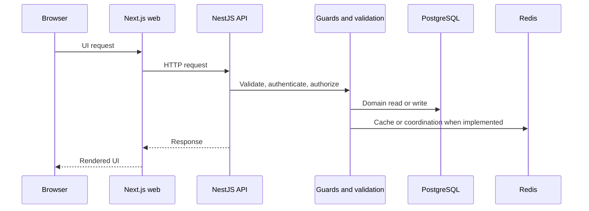

# Data Flow

The principal request path is browser to Next.js and/or NestJS, then to PostgreSQL and Redis. The API applies authentication, tenant context, and authorization controls before protected domain operations.

Connect also accepts authenticated Socket.IO connections at `/connect` and uses Redis adapters for cross-replica room communication when available. TODO Confirm with team: event-delivery guarantees and production topology.