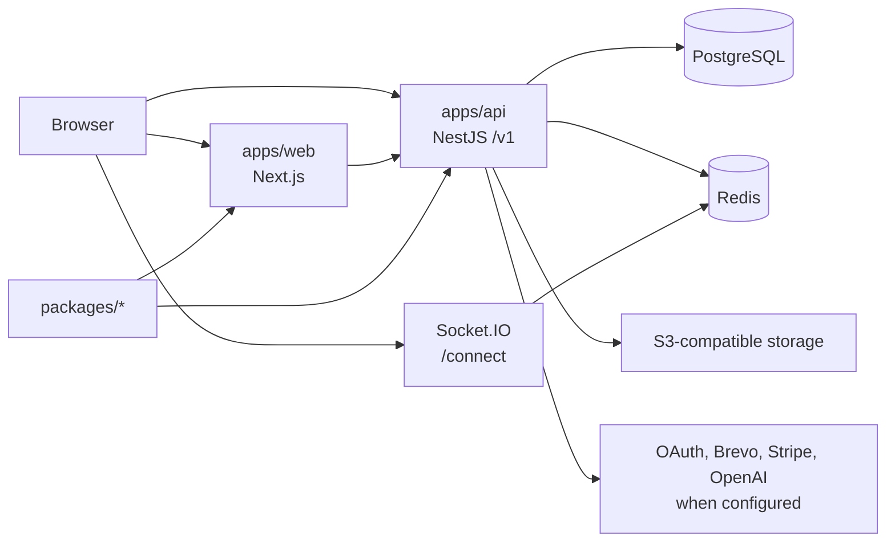

# Architecture Overview

Dhriti is a layered pnpm monorepo. The checked-in runtime consists of a Next.js web application, a NestJS API, PostgreSQL, Redis, and optional managed Redis infrastructure. Shared packages provide cross-application code.

## Boundaries

- `apps/web` is the Next.js 16 application and consumes workspace packages including UI, auth, validation, types, and API client.
- `apps/api` is the NestJS 11 backend. Its `AppModule` composes configuration, database, Redis, authorization, product modules, health, metrics, jobs, and WebSocket modules.
- `packages/ui` contains reusable presentation components; product-specific orchestration belongs in application modules.
- `prisma/parts` contains the canonical Prisma fragments; a script produces `prisma/schema.prisma`.
- `infrastructure/docker` provides a local API stack, and `infrastructure/terraform` currently contains a managed Redis module.

## Runtime behaviors

The API enables Helmet, CORS, a global validation pipe, a global authentication guard, request logging and metrics interceptors, and a global HTTP exception filter. It exposes liveness and readiness probes. Readiness requires both PostgreSQL and Redis to answer successfully.

Redis is explicitly not the persistent source of truth; [the cache policy](redis-cache-policy.md) names PostgreSQL as authoritative for business data.

## Unknown deployment boundaries

There is no checked-in worker application despite root scripts and legacy README layout references to `apps/worker`; the pnpm workspace currently includes only folders present under `apps/*`. TODO Confirm with team whether a worker runtime is planned, external, or intentionally removed.

TODO Confirm with team: production topology, API and web hosting, ingress/TLS termination, S3 provider, external provider ownership, and disaster-recovery objectives are not fully specified by repository assets.
