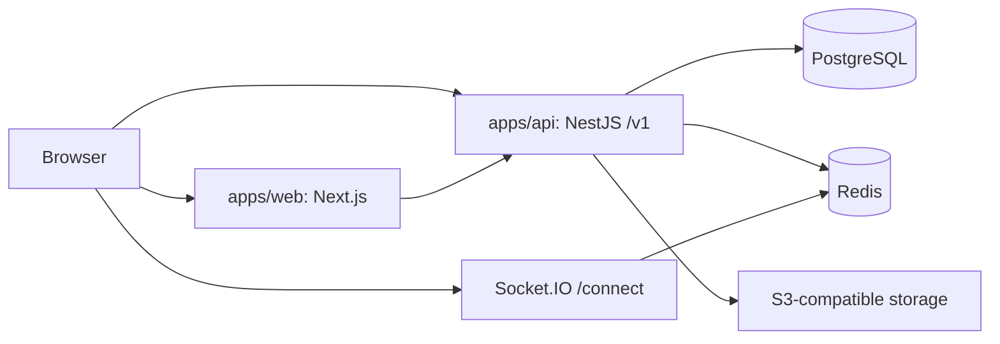

# System Overview

The checked-in runtime consists of a Next.js web application, a NestJS API, PostgreSQL, Redis, and optional external integrations. [Architecture Overview](overview.md) records the surrounding boundaries and unknown production topology.

PostgreSQL is authoritative for persistent business data; Redis is cache and coordination infrastructure. TODO Confirm with team: production ingress, compute, hosting, and external-provider ownership.
