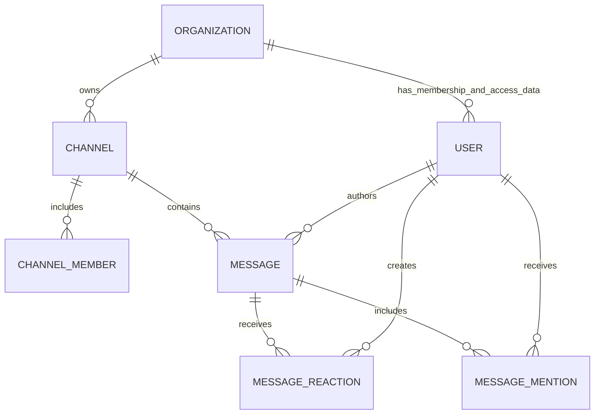

# Entity Relationship Diagram

The diagram shows evidence-backed high-level relationships, not every Prisma model or cardinality constraint. Consult `prisma/parts` for the source schema.

TODO Confirm with team: whether this diagram should be expanded and maintained as a complete data-model artifact.